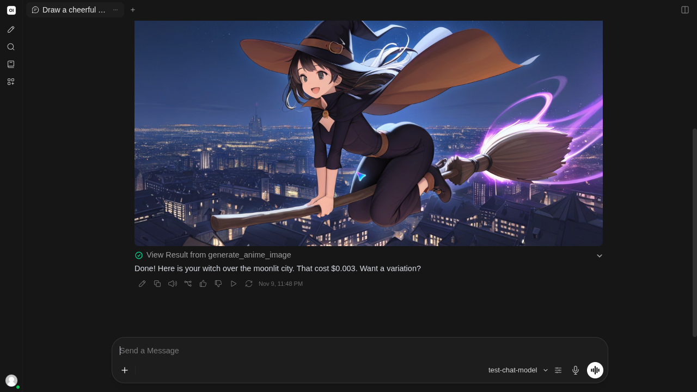

# AnimeAPI for Open WebUI

Anime image generation inside [Open WebUI](https://github.com/open-webui/open-webui) with [AnimeAPI](https://animeapi.ai) at **$0.003 per image**, one of the cheapest anime image APIs. Prepaid balance from $5 that never expires, no subscription; new accounts get 3 free images without a card.

There are two ways to use it. Both need an AnimeAPI key from https://animeapi.ai/dashboard/api-keys (keys start with `ank_`).

| | What you get | Setup |
| --- | --- | --- |
| **A. Built-in image generation** | Open WebUI's own image button and "Generate image" action draw with AnimeAPI. | Four fields in Admin Settings, no code. |
| **B. The AnimeAPI tool** | Your chat model decides when to draw, writes the prompt, picks the shape, and the picture appears in its reply. | Paste one Python file. |



## A. Built-in image generation (no code)

AnimeAPI has an OpenAI-compatible endpoint, so Open WebUI can use it directly.

1. **Admin Panel → Settings → Images.**
2. Turn on **Image Generation**.
3. **Image Generation Engine:** `Default (Open AI)`.
4. **OpenAI API Base URL:** `https://animeapi.ai/v1`
5. **OpenAI API Key:** your `ank_...` key.
6. **Model:** type `anime` ($0.003 per image), `ultra` ($0.01) or `ultra-max` ($0.02). The dropdown suggests other names; type ours instead.
7. **Image Size:** `1024x1024` for square, `1024x1536` for portrait, `1536x1024` for landscape. Only the shape is used.
8. Save.

Or with environment variables:

```bash
ENABLE_IMAGE_GENERATION=true
IMAGE_GENERATION_ENGINE=openai
IMAGES_OPENAI_API_BASE_URL=https://animeapi.ai/v1
IMAGES_OPENAI_API_KEY=ank_your_key
IMAGE_GENERATION_MODEL=anime
IMAGE_SIZE=1024x1024
```

Open WebUI downloads each image into its own storage, so pictures stay in your chats.

Mature output: this path uses the API's own default for mature output on the anime model. To have it off, use the tool below, where it is off by default.

## B. The AnimeAPI tool

1. **Workspace → Tools → +** (New Tool).
2. Paste the contents of [`animeapi_tool.py`](animeapi_tool.py) and save.
3. Click the gear on the tool (**Valves**) and paste your key into **Api Key**.
4. In a chat, press **+** below the message box and switch on **AnimeAPI Anime Image Generator** (or attach it to a model for good under Workspace → Models).
5. Ask: *"Draw a cheerful witch flying over a moonlit city, landscape."*

Use a chat model that supports tool calling, and set **Function Calling** to `Native` in the model's advanced parameters for the most reliable results.

Settings (Valves):

| Setting | Default | What it does |
| --- | --- | --- |
| Api Key | empty | Your `ank_...` key. |
| Default Model | `anime` | `anime` $0.003, `ultra` $0.01, `ultra-max` $0.02 per image. The chat model may pick another when asked. |
| Allow Nsfw | **off** | Mature output is off by default in this tool, because chat output is often shared. |
| Enhance Prompt | on | Rewrites plain English into tags for the anime model. |
| Keep Image In Chat | on | Stores the image in the chat. AnimeAPI image links are not permanent storage; with this off the chat only keeps the link. |
| Base Url | `https://animeapi.ai` | Leave as is. |

The tool tells the chat model what each image cost and the balance left, so you can ask "how much have I got left?".

## Prices

| Model | Price per image | Use it for |
| --- | --- | --- |
| `anime` | **$0.003** | Characters, portraits, avatars, scenes. About 4 seconds. |
| `ultra` | $0.01 | Long, detailed prompts; legible text in the image. |
| `ultra-max` | $0.02 | Highest detail. |

## Tested

Both paths were run against Open WebUI 0.13.3 with real generations: the built-in engine returned and stored a 1024x1024 image, and the tool produced the chat shown above.

## Also available

AnimeAPI is a remote MCP server too (`https://animeapi.ai/mcp`); Open WebUI can add it under Admin Settings → External Tools as an MCP (Streamable HTTP) server with the key as a Bearer token. See [animeapi-ai/animeapi-mcp](https://github.com/animeapi-ai/animeapi-mcp).

## Licence

MIT
